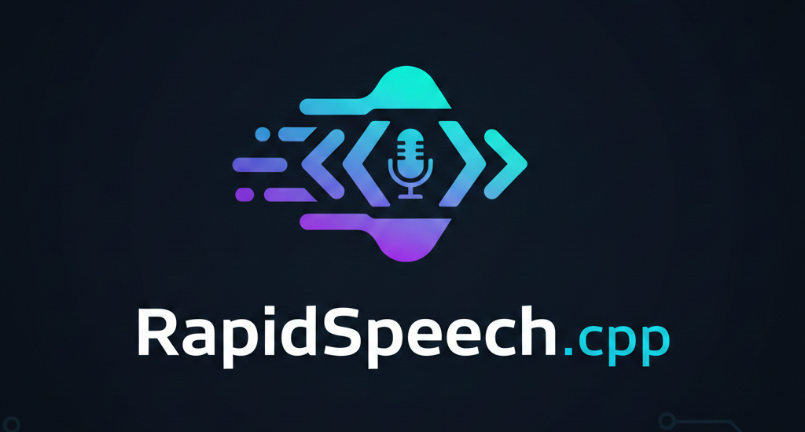

<div align="center">


<h1>RapidSpeech.cpp</h1>

<p><strong>让语音 AI 留在用户的设备上。</strong></p>

<p>
语音识别 · 流式识别 · 语音合成 · VAD · 声音克隆<br />
一套原生 C/C++ runtime，Python 易用，GGUF 驱动。
</p>

<p>
<a href="https://rapidai-rapidspeech-wasm.ms.show"><strong>浏览器直接体验</strong></a>
· <a href="https://colab.research.google.com/github/RapidAI/RapidSpeech.cpp/blob/main/colab/RapidSpeech_Quickstart.ipynb">在 Colab 运行</a>
· <a href="https://www.modelscope.cn/models/RapidAI/RapidSpeech/files?version=main">下载模型</a>
· <a href="docs/cli.md">CLI 文档</a>
</p>

<p>
<a href="https://huggingface.co/RapidAI/RapidSpeech"></a>
<a href="https://www.modelscope.cn/models/RapidAI/RapidSpeech/files?version=main"></a>
<a href="https://github.com/RapidAI/RapidSpeech.cpp/stargazers"></a>
</p>
</div>

简体中文 | [English](./README.md)

RapidSpeech.cpp 让应用在本地完成语音识别、语音合成、VAD 和声音克隆，无需把音频
发送到云端。底层是基于 ggml 的纯 C/C++ runtime，模型统一使用 GGUF；Python 用户
可以直接安装 wheel，不需要在运行时携带沉重的 PyTorch 模型栈。

------

## 安装，然后直接识别或合成

```bash
# 根据设备选择一个安装包
pip install rapidspeech-metal  # macOS / Apple Silicon
pip install rapidspeech-cuda   # Linux / NVIDIA
pip install rapidspeech        # CPU，Linux / Windows

rapidspeech transcribe your-audio.wav             # 语音 → 文字
rapidspeech speak "你好，欢迎使用语音合成。" -o hello.wav   # 文字 → 语音
rapidspeech serve                                # OpenAI API + 浏览器控制台
```

不用填模型路径，不用装 CMake，不用改配置。首次运行自动下载默认模型
（sha256 校验、断点续传，缓存在 `~/.cache/rapidspeech/models/`）；文件缓存后，
推理过程不再访问网络。设置 `RAPIDSPEECH_OFFLINE=1` 可强制离线模式。

Apple M1 Pro 使用 Metal 的一次实际运行结果：

```text
$ rapidspeech transcribe news-15s.wav
model: FunASRNano  backend: MTL0
15.10s audio in 2.08s (RTF 0.138)
国家发展改革委等部门发布关于开展重点行业节能降碳改造攻坚三年行动的通知。通知提出，重点行业能源消耗和二氧化碳排放的规模大、强度高。
```

哪里不对？`rapidspeech doctor` 会自检安装、后端和模型缓存，并对每个问题给出
明确的修复命令。全部命令（`models`、`pull`、离线模式、镜像切换）见
[docs/cli.md](docs/cli.md)。

想一次看到完整闭环？`rapidspeech demo` 会在本地打开一个浏览器页面：按住说话
识别、文本合成、以及把你说的话用 TTS 朗读回来的「回声模式」——页面上直接显示
加载的模型、后端和每次请求的延迟，所有数据不出 localhost。

要做本地语音应用？`rapidspeech serve` 会启动 native server，打开
`http://127.0.0.1:8080/webui.html`，并在同一个进程里提供 OpenAI 兼容
HTTP 和 WebSocket 流式 ASR/TTS 接口。

> 默认 TTS 是中文 Kokoro v1.1-zh。模型注册表提供了一组精选音色包，中文中夹带
> 英文单词也可以直接处理。英文和声音克隆 TTS 见[模型文档](#文档)。

## 安装前先体验

浏览器 Demo 使用 WebAssembly 和 WebGPU 在客户端完成推理：

- [ModelScope 浏览器 Demo](https://rapidai-rapidspeech-wasm.ms.show)
- [Hugging Face 浏览器 Demo](https://rapidai-rapidspeech-wasm.hf.space)
- [Google Colab 快速体验](https://colab.research.google.com/github/RapidAI/RapidSpeech.cpp/blob/main/colab/RapidSpeech_Quickstart.ipynb)

其中包含离线 ASR、麦克风 ASR + VAD 和本地 TTS。模型与音频都留在当前浏览器会话中。

## 在 Python 里使用

```bash
rapidspeech pull funasr-nano     # 输出模型的本地路径
```

```python
import os
import rapidspeech

model = os.path.expanduser("~/.cache/rapidspeech/models/funasr-nano-q4_k_m.gguf")
asr = rapidspeech.asr_offline(model)
asr.push_audio(pcm)              # 1-D float32 单声道 PCM
asr.process()
print(asr.get_text())
```

TTS、流式 ASR、VAD 和声音克隆：[Python 示例](python-api-examples/README.md)。

------

## 可以用它构建什么

- **私有转写工具**：离线文件、VAD 分段，以及针对人名和行业术语的热词偏置。
- **实时字幕和语音输入**：麦克风流式识别，持续输出 partial 和 final 结果。
- **本地语音输出**：多语种 TTS、情感合成和零样本声音克隆。
- **本地语音服务**：一个服务同时提供 OpenAI 兼容 HTTP、WebSocket 流式接口和 MCP。
- **浏览器与原生应用**：WASM/JavaScript、Python、C API 和独立 C++ 可执行文件。

------

## 为什么是 RapidSpeech.cpp

1. **从架构上保证本地运行。** 音频由当前设备上的原生 runtime 处理；模型下载行为
   明确可见，并可强制进入离线模式。
2. **提供完整语音工作流，而不只是模型执行器。** VAD、流式缓冲、热词偏置、中文
   文本归一化、说话人嵌入、模型量化和服务接口都在同一项目中。
3. **一套核心，多种部署方式。** 原型阶段使用 Python，之后可以嵌入 C API、发布
   原生可执行文件、启动本地服务，或把工作流放进浏览器。

统一 GGUF 模型格式面向 CPU、Metal、CUDA、Vulkan、CANN、OpenCL 和 WebGPU。
不同模型的后端支持和优化程度并不完全相同，模型文档会记录当前路径与已知限制。

------

## 实测性能

Apple M1 Pro、macOS、默认模型、热推理、每项 5 次。下表由
[`benchmarks/results/`](benchmarks/results/) 中的原始 JSON 生成——测量规则与
一条命令复现方式见 [benchmarks/README.md](benchmarks/README.md)：

| 任务 | 模型 | 后端 | 冷启动 | RTF（中位数） | RTF（P95） |
| --- | --- | --- | --- | --- | --- |
| ASR | funasr-nano q4_k_m（692 MB） | Metal | 0.78 秒 | 0.106 | 0.132 |
| ASR | funasr-nano q4_k_m | CPU ×4 | 0.41 秒 | 0.172 | 0.210 |
| TTS | kokoro-zh q8_0（107 MB） | Metal | 0.24 秒 | 0.362 | 0.363 |
| TTS | kokoro-zh q8_0 | CPU ×4 | 0.13 秒 | 0.693 | 0.758 |

RTF = 处理时间 / 音频时长，越低越快，小于 1 表示快于实时。结果会受到硬件、后端、
模型、量化类型和输入影响；CLI 每次运行都会输出 RTF。CUDA / Windows / WASM 平台在
[benchmarks/README.md](benchmarks/README.md) 中标注为「等待社区复现」——我们只发布
实测，不发布估计。[OmniVoice 文档](docs/omnivoice.md#performance-rtf)提供了单模型
的量化与步数对比。

------

## 当前支持

| 任务 | 模型 | 状态 |
| --- | --- | --- |
| ASR | SenseVoice-small, FunASR-nano, X-ASR（Zipformer2，流式） | 稳定 |
| VAD | Silero VAD, FireRedVAD | 稳定 |
| TTS | Kokoro, CosyVoice3, OmniVoice, OpenVoice2, IndexTTS-2 | 活跃开发 |
| Speaker | CAMPPlus | 稳定 |

**X-ASR** — 中英文 Zipformer2 transducer（icefall/k2）。一份 GGUF 同时支持**离线**
全上下文解码与**真正的分 chunk 流式**（逐层左上下文缓存、亚秒级出字，
`--chunk-len 16/32/48/96/192` fbank 帧）。带标点和大小写，greedy transducer 解码，
可在 CPU / Metal / CUDA / Vulkan 上运行，可量化到 q4_k_m（99.5 MB）。详见
[docs/x-asr.md](docs/x-asr.md)。

**IndexTTS-2** — 带情感控制的零样本语音克隆 TTS（GPT + S2Mel CFM + BigVGAN-v2
声码器），4 种情感控制模式（参考音频 / 向量 / 文本 / Qwen）。详见
[docs/index2tts.md](docs/index2tts.md)。

## 选择适合你的入口

| 入口 | 适用场景 | 从这里开始 |
| --- | --- | --- |
| `rapidspeech` CLI | 首次体验、脚本和本地工具 | [CLI 文档](docs/cli.md) |
| Python API | 应用集成和 NumPy 音频处理 | [Python 示例](python-api-examples/README.md) |
| 原生 C API | 桌面/移动端绑定与嵌入式 runtime | [`include/rapidspeech.h`](include/rapidspeech.h) |
| HTTP/WebSocket/MCP | 本地服务和 Agent 集成 | [Server 文档](examples/server/README.md) |
| 浏览器 WASM | 客户端 ASR、VAD 和 TTS | [WASM 文档](wasm-examples/README.md) |
| Node.js | 基于 WASM runtime 的 JavaScript 工具 | [Node.js 示例](node-api-example/README.md) |

## 开发中

Qwen3-ASR、Qwen3-TTS。

------

## 文档

- [Python 示例](python-api-examples/README.md)
- [技术说明](docs/TECHNICAL-CN.md)：架构、设计取舍、后端、模型转换和绑定接口。
- 模型使用说明：
  - ASR — [X-ASR](docs/x-asr.md)（Zipformer2，流式）·
    [SenseVoice](docs/sensevoice.md) · [FunASR-Nano](docs/funasr-nano.md)
  - TTS — [IndexTTS-2](docs/index2tts.md)（音色克隆 + 情感）·
    [CosyVoice3](docs/cosyvoice3.md) · [OmniVoice](docs/omnivoice.md) ·
    [OpenVoice2](docs/openvoice2.md) · [Kokoro](docs/kokoro.md)
  - VAD — [Silero / FireRedVAD](docs/vad.md)
  - 说话人 — [CAMPPlus](docs/campplus.md)
- [浏览器 / WASM 示例](wasm-examples/README.md)
- [Node.js 示例](node-api-example/README.md)

------

## 原生 C++ CLI

### 模型下载

pip CLI 会自动处理（见本页顶部）。原生 C++ CLI 需要手动下载 GGUF 文件：

- 🤗 Hugging Face：https://huggingface.co/RapidAI/RapidSpeech
- ModelScope：https://www.modelscope.cn/models/RapidAI/RapidSpeech

### 从源码构建

```bash
git clone https://github.com/RapidAI/RapidSpeech.cpp
cd RapidSpeech.cpp
git submodule sync && git submodule update --init --recursive
cmake -B build
cmake --build build --config Release
```

**独立可执行文件**（无 DLL/.so 运行时依赖）—— 用 `-DRS_STATIC_EXE=ON` 把 core 和
ggml 静态编译进每个 CLI：

```bash
# Windows / MSVC
cmake -B build -G "Visual Studio 17 2022" -A x64 -DRS_STATIC_EXE=ON
cmake --build build --config Release --parallel
# Linux / macOS
cmake -B build -DRS_STATIC_EXE=ON -DCMAKE_BUILD_TYPE=Release
cmake --build build -j
```

构建产物位于 `build/` 目录：
- `rs-asr-offline` — 离线 ASR 命令行工具
- `rs-asr-vad-online` — VAD 切段的伪流式 ASR 命令行工具
- `rs-asr-online` — 真正的分 chunk 流式 ASR（X-ASR；麦克风或 WAV，实时出字）
- `rs-tts-offline` — 离线 TTS 命令行工具
- `rs-server` — OpenAI 兼容 HTTP API + MCP 服务器（ASR + TTS）
- `rs-quantize` — 模型量化工具

### 核心命令

**离线 ASR**

```bash
./build/rs-asr-offline \
  -m /path/to/funasr-nano-fp16.gguf \
  -w /path/to/audio.wav \
  -t 4 \
  --gpu true
```

**VAD 分段 ASR**

```bash
./build/rs-asr-offline \
  -m /path/to/funasr-nano-fp16.gguf \
  -v /path/to/silero_vad_v6.gguf \
  -w /path/to/audio.wav \
  -t 4 \
  --vad-threshold 0.5 \
  --silence-ms 600
```

**热词偏置（FunASR-Nano）**

```bash
# 纠正专有名词/谐音；也可用 --hotword-file 传大词库
./build/rs-asr-offline \
  -m /path/to/funasr-nano-fp16.gguf \
  -w /path/to/audio.wav \
  --hotwords "阿里巴巴"
```

> 详见 [docs/funasr-nano.md](docs/funasr-nano.md#6-热词rag-上下文偏置)。

**流式 ASR（X-ASR）**

```bash
# WAV：实时速率回放 + 实时出字（加 --fast 则尽快跑完）
./build/rs-asr-online -m /path/to/xasr-q4_k_m.gguf -w /path/to/audio.wav --chunk-len 32
# 麦克风
./build/rs-asr-online -m /path/to/xasr-q4_k_m.gguf --mic --chunk-len 16
```

模型、chunk 大小/延迟权衡与 GGUF 转换详见 [docs/x-asr.md](docs/x-asr.md)。

**文本转语音**

```bash
./build/rs-tts-offline \
  -m /path/to/omnivoice-f16.gguf \
  -t "Hello, welcome to RapidSpeech!" \
  --instruct "male, young adult, moderate pitch" \
  --lang English \
  --n-steps 32 \
  -o output.wav
```

**模型量化**

```bash
./build/rs-quantize /path/to/input-f16.gguf /path/to/output-q4_k.gguf q4_k
```

**服务器（OpenAI API + MCP）**

```bash
# pip 包入口：自动下载默认模型，启动 API，打开浏览器控制台
rapidspeech serve

# native build 入口：用 OpenAI 兼容 HTTP API 和 MCP 同时提供 ASR + TTS
./build/rs-server --asr-model xasr.gguf --tts-model omnivoice.gguf --port 8080

curl http://127.0.0.1:8080/v1/audio/transcriptions -F file=@audio.wav -F model=rapidspeech-asr
curl http://127.0.0.1:8080/v1/audio/speech -H 'content-type: application/json' \
     -d '{"input":"你好","voice":"female","language":"Chinese"}' --output out.wav
```

也可作为 MCP 服务器运行（stdio 给 Claude Desktop，或 `POST /mcp`），并提供
WebSocket 流式接口（带 partial/final 的流式 ASR、VAD 切段 ASR、分段与纯流式
TTS），以及一个浏览器测试台（`--web-dir examples/server` →
`http://host:port/webui.html`）。详见 [examples/server/README.md](examples/server/README.md)。

### Python

离线 ASR、流式 ASR、离线 TTS、流式 TTS、VAD 和声音克隆见 [Python 示例](python-api-examples/README.md)。

------

## 🤝 参与贡献

能够提供复现命令和可检查结果的贡献最有价值。当前优先方向：

- 跨平台安装与 wheel 验证。
- 可复现的延迟、内存和质量 benchmark。
- 流式、Metal、CUDA、Vulkan 与 WebGPU 性能。
- 文档和首次运行示例。
- 同时包含转换脚本、对拍验证和已知限制的模型适配。

开始大型模型适配前，建议先提交 issue，以便实现方案与 runtime 架构保持一致。

## 致谢

1. [Fun-ASR](https://github.com/FunAudioLLM/Fun-ASR)
2. [llama.cpp](https://github.com/ggml-org/llama.cpp)
3. [ggml](https://github.com/ggml-org/ggml)
4. [cppjieba](https://github.com/yanyiwu/cppjieba) —— 中文分词
5. [WeText](https://github.com/wenet-e2e/wetext) —— 文本归一化（ITN/TN）
6. [miniaudio](https://github.com/mackron/miniaudio) —— 单文件音频 I/O
7. [X-ASR](https://github.com/Gilgamesh-J/X-ASR) —— 重点面向流式 ASR 和低延迟部署，同时支持离线识别
